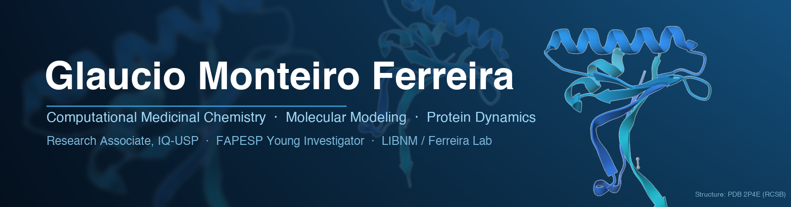

  
  
  
  
  

---

## 👨‍🔬 About me

I am a **Research Associate at the Institute of Chemistry, University of São Paulo (IQ-USP)**, Department of Chemistry, and a **FAPESP Young Investigator** (grant [2023/15933-4](https://bv.fapesp.br/pt/auxilios/119151/plataforma-de-triagem-de-medicamentos-por-modelagem-molecular-mmdsp-um-modelo-de-insights-pre-clinic/)). I lead the **LIBNM · Ferreira Lab** (Integrative Laboratory for the Bioprospecting of New Molecules).

I hold a BSc in Pharmacy (UFES) and a PhD in Pharmaceutical Sciences, Medicinal Chemistry (USP), with postdoctoral training at FCF-USP, the University of Tübingen and the Dante Pazzanese Institute of Cardiology. My work combines **molecular modeling, molecular dynamics and data science** to understand how proteins move, are regulated and interact with drugs, and to apply this to the **rational design of new medicines**.

**Current project:** a molecular-modeling drug screening platform (MMDSP) that generates molecular and preclinical evidence for a new lipid-lowering drug targeting **PCSK9**.

## 🔬 Research interests

- 🧬 **Molecular dynamics** of proteins, protein–protein and protein–ligand complexes
- 🧭 **Markov state models (MSM)**, principal component analysis (PCA) and allosteric signal transduction
- 💊 **Computational medicinal chemistry:** docking, virtual screening and structure-based drug design
- 🫀 **Dyslipidemia and familial hypercholesterolemia:** PCSK9, LDLR and the effect of missense variants
- 🦠 **Antiviral targets:** SARS-CoV-2 proteases (Mpro and PLpro)
- 🧪 **Nuclear receptors:** FXR/RXR heterodimers and steroidal antagonists
- 🧫 **Neglected diseases:** *Trypanosoma cruzi* sirtuin 2 inhibitors

## 📂 Featured projects

| Repository | Description |
|---|---|
| [**PCSK9-analysis**](https://github.com/gmf12/PCSK9-analysis) | PCA of MD simulations of the PCSK9–LDLR complex and the effect of missense variants found in Brazilian familial hypercholesterolemia patients |
| [**LDLR-analysis**](https://github.com/gmf12/LDLR-analysis) | LDLR simulations in a membrane and the impact of missense variants on conformation and intramolecular interactions |
| [**FXR-RXR_analysis**](https://github.com/gmf12/FXR-RXR_analysis) | Allosteric signal transduction in FXR/RXR heterodimers bound to steroidal antagonists (MSM, inter-domain angles) |
| [**NR_MSM**](https://github.com/gmf12/NR_MSM) | Markov state models for nuclear receptors |
| [**pcaanalysismrpo**](https://github.com/gmf12/pcaanalysismrpo) | SARS-CoV-2 Mpro conformational changes induced by covalently bound ligands |
| [**plpronalysis**](https://github.com/gmf12/plpronalysis) | SARS-CoV-2 papain-like protease: inhibitor accessibility promoted by the BL2 loop |
| [**SurA**](https://github.com/gmf12/SurA) | Markov state model analysis of the periplasmic chaperone SurA |
| [**ferreira-lab-site**](https://github.com/gmf12/ferreira-lab-site) | Source of the LIBNM · Ferreira Lab website ([ferreiralab.com.br](https://ferreiralab.com.br)) |

## 🛠 Tools

<b>💻 Languages and data analysis</b>

 

<b>🧬 Molecular modeling and simulation</b>

 

<b>🌐 Web and outreach</b>

 

## 📊 GitHub

  
  

## 🤝 Collaboration

Open to collaborations in **molecular modeling, molecular dynamics simulation and drug discovery**, and to supervising undergraduate, MSc, PhD and postdoctoral researchers. See the group website at [ferreiralab.com.br](https://ferreiralab.com.br), write to [gmf@usp.br](mailto:gmf@usp.br) or reach me on [LinkedIn](https://www.linkedin.com/in/gmf1/).

